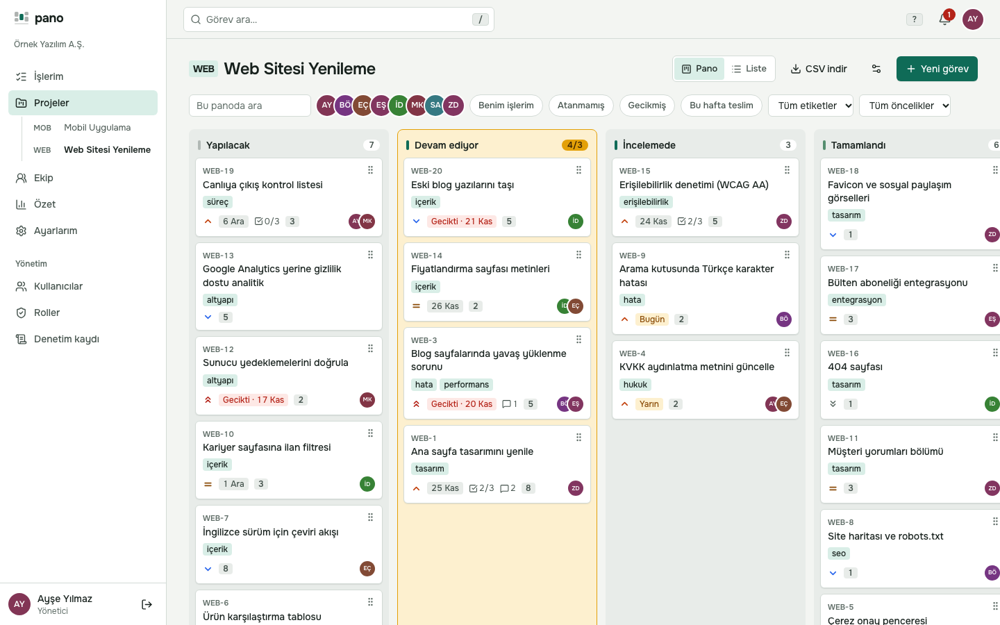
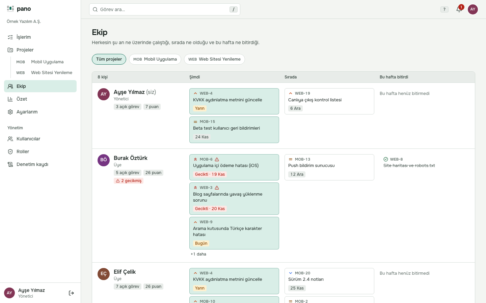
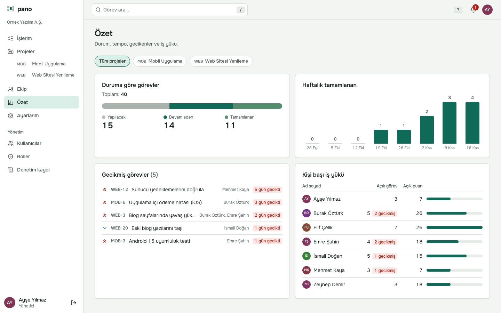
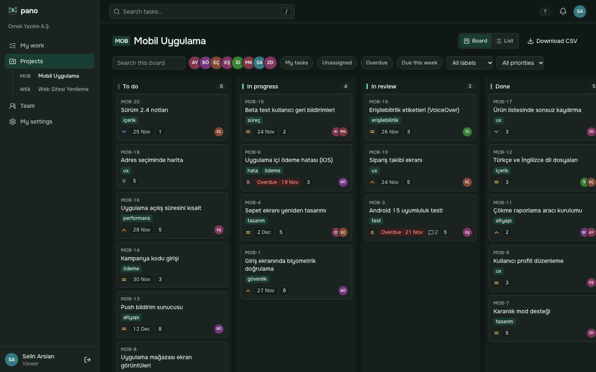
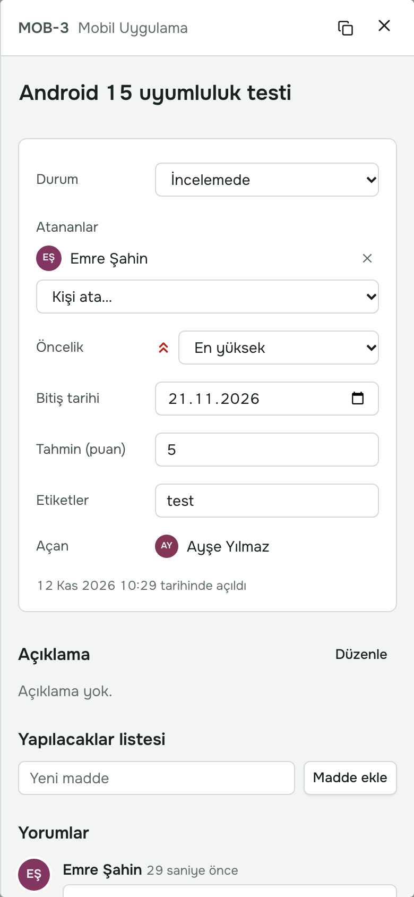

# pano

**pano** (Turkish for "board") is a web app a company uses to run its work on a board: a focused, friendly subset of Jira. Each company gets its own isolated workspace; the admin adds people, gives them roles and permissions, and everyone can see who is working on what, what is next and what got done.

> **TR:** pano, şirketlerin işlerini tek panoda yürütmesi için yapılmış bir web uygulamasıdır. Şirket hesabını açan kişi yönetici olur, ekibi ekler, rolleri ve yetkileri belirler. Herkes kimin neyle uğraştığını, sırada ne olduğunu ve neyin bittiğini görür. Arayüz varsayılan olarak Türkçedir; İngilizce de tam olarak desteklenir.



| Team: now / next / done this week | Task detail |
| --- | --- |
|  |  |
| **My work** | **Overview dashboard** |
|  |  |
| **English, dark mode (a read-only viewer)** | **Users and roles** |
|  |  |

<p>
  
  
  
</p>

All screenshots come from the running app with the demo data (`scripts/screenshots.ts`).

## Quickstart

Requirements: Node.js 22 and npm. No database server or Docker needed for development.

```bash
npm install
npm run dev        # seeds the demo company on first run, then serves http://localhost:4500
```

Development and tests use [PGlite](https://pglite.dev) (Postgres compiled to WebAssembly) stored in `.data/pglite`. Delete that folder to start over; `npm run seed` adds the demo company to an empty database.

### Demo logins

All demo accounts are fictional and share the password **`PanoDemo2026`** (demo only).

| Email | Name | Role |
| --- | --- | --- |
| `ayse@ornek.test` | Ayşe Yılmaz | Admin (Yönetici) |
| `mehmet@ornek.test` | Mehmet Kaya | Manager (Proje yöneticisi) |
| `zeynep@ornek.test` | Zeynep Demir | Member (Üye) |
| `emre@ornek.test` | Emre Şahin | Member |
| `elif@ornek.test` | Elif Çelik | Member |
| `burak@ornek.test` | Burak Öztürk | Member |
| `ismail@ornek.test` | İsmail Doğan | Custom role "Stajyer" (intern) |
| `selin@ornek.test` | Selin Arslan | Viewer (İzleyici), interface in English |

The demo company "Örnek Yazılım A.Ş." has two projects (WEB, MOB) and 40 tasks in Turkish at various states. You can also create your own company at `/signup`.

## What it does

**Companies and people**
- Company sign-up creates an isolated workspace; the first user is its admin.
- Admins add users (name, email, role, language) and either get a one-time **invite link** (valid 7 days) or set a **temporary password** that must be changed at first sign-in. No email is sent in v0.1; the link is shown once to copy. `src/server/mail.ts` is the hook for SMTP.
- Built-in roles: **Admin**, **Manager**, **Member**, **Viewer** (read-only). Admins create **custom roles** by ticking permissions: manage users, manage roles, manage projects/boards, create tasks, edit any task, delete tasks, assign self, assign others, comment, view reports.
- Projects can be **restricted** to selected people (admins and managers always see every project).
- Deactivating a user ends their sessions immediately and keeps their history. Admins can reset passwords (new link or temporary password). The **audit log** records user created, role changed, access turned off/on, password reset, role created/changed/deleted and task deleted.

**The board**
- One kanban board per project. Default columns: Yapılacak / To do, Devam ediyor / In progress, İncelemede / In review, Tamamlandı / Done. Managers rename, add, reorder and delete (empty) columns, set each column's type (to do / in progress / done) and an optional **WIP limit**: the column turns amber when exceeded.
- Tasks have a key (e.g. `WEB-42`), title, Markdown description (raw HTML is never rendered), one or more assignees, reporter, priority with icons, labels, due date, estimate (points), a checklist with progress, comments with **@mentions** (suggestions while typing) and a full history.
- **Drag and drop** between and within columns with the mouse, a long press on touch screens, or the keyboard (focus a card's handle, Space, arrow keys, Space). The task panel's Status field is another keyboard-friendly way to move a task.
- **Assign to me** on the card and in the task panel; assign others from the panel. Moves are optimistic and roll back with a message if the server refuses.
- **Concurrent edits never silently overwrite each other**: every task change carries the version the user saw; a stale change is rejected and the latest version is loaded.
- Quick filters: my tasks, unassigned, overdue, due this week, assignee avatars, label, priority and text. A **list view** shows the same filtered tasks as a table.

**Seeing what everyone is doing**
- **My work (İşlerim)**: my tasks grouped in progress / to do / recently done, overdue first.
- **Team (Ekip)**: one row per person with what they are doing now, what is next and what they finished this week, with open-task and point counts and overdue warnings, filterable by project. Each person has a profile with the same view plus their recent activity.
- **Overview (Özet)** for people with "view reports": tasks by status, done per week (8 weeks), overdue list and workload per person.

**Extras**
- In-app **notifications** with an unread badge: assigned to you, mentioned, due tomorrow.
- **Keyboard shortcuts**: `c` new task, `/` search, `?` help, `Esc` closes dialogs.
- **Search** across all visible tasks, Turkish-aware: `istanbul` finds "İstanbul", `ılık` finds "ILIK", and Turkish letters are optional (`tasinmasi` finds "taşınması").
- **Copy task** (fields and checklist), **CSV export** per project (Excel-friendly, formula-safe).
- **Dark mode** (system, light or dark per user) and a **mobile layout** with a bottom tab bar.
- Turkish is the default language; English is complete. Each user picks a language; the sign-in page has a switch. Dates, numbers and plurals follow tr-TR / en-GB.

## Security model

- **Tenant isolation**: every table row carries `workspace_id`; every service query filters by the caller's workspace and project visibility. Records from another company are answered with "not found", never "forbidden", so IDs leak nothing. `tests/tenant-isolation.test.ts` runs a company-B admin (who holds every permission) against company A's IDs for **every server action** in `src/app/actions.ts`, and a meta-test fails if an action is added without such a case.
- **Permissions are enforced on the server** in `src/server/*`; the UI only hides what you cannot do. Nobody can grant, or act on someone holding, permissions they do not have themselves (no privilege escalation through "manage users"). The company always keeps an active admin.
- **Auth**: email + password, hashed with scrypt (N=2^17, r=8, p=1) from `node:crypto`. Sessions are random 256-bit tokens in an HttpOnly, Secure, SameSite=Lax cookie; only their SHA-256 is stored. Sessions end on sign-out, deactivation, role change, permission change of a custom role, password reset and password change (other devices).
- **Sign-in protection**: 5 wrong passwords lock the account for 15 minutes; an in-memory per-IP limit caps attempts (see Limits). Password policy: at least 10 characters with letters and digits.
- **CSRF**: all mutations are Next.js Server Actions, which reject cross-origin requests; cookies are SameSite=Lax. The only route handler is a read-only CSV download.
- **Validation** with zod at every server boundary. Markdown is rendered without raw HTML and with unsafe URLs stripped. `X-Frame-Options: DENY`, `nosniff`, `Referrer-Policy: same-origin`.

## Development

```bash
npm run dev         # http://localhost:4500 (PGlite in .data/pglite)
npm test            # vitest: permissions, tenant isolation, business rules (in-memory PGlite)
npm run typecheck
npm run lint
npm run build && npm run e2e   # Playwright journey against a production build on :4501
npx tsx scripts/screenshots.ts docs/screenshots   # with a seeded app running on :4500
```

Stack: Next.js 16 (App Router, Server Actions) · React 19 · TypeScript · Drizzle ORM · PostgreSQL (PGlite locally) · Tailwind CSS 4 · dnd-kit · zod · vitest · Playwright.

Layout:

```
src/db/          schema (Drizzle) and the connection (PGlite or Postgres)
src/server/      services: all business rules, permission checks and workspace scoping
src/app/actions.ts  thin Server Actions: session -> service
src/app/         pages (App Router)
src/components/  UI
src/lib/i18n/    tr.ts (source) and en.ts (type-checked to have the same keys)
drizzle/         SQL migrations (applied automatically at startup)
tests/ e2e/      vitest and Playwright
```

After changing `src/db/schema.ts`, run `npm run db:generate` to create a migration.

## Deploying

Production uses a real Postgres via `DATABASE_URL`; migrations run on startup.

```bash
docker compose up --build     # app on http://localhost:4500 + postgres:17
```

Then open `/signup` to create your company (the demo seed is not run in Docker). Configuration (see `.env.example`): `DATABASE_URL`, `APP_TZ` (default `Europe/Istanbul`), `COOKIE_SECURE` (default `true`; put HTTPS in front of the app). Change `POSTGRES_PASSWORD` for anything beyond a local try-out.

## Limits in v0.1

- The per-IP sign-in limiter lives in process memory: fine for one app instance; use a shared store when running several. Behind a proxy, make sure `X-Forwarded-For` is set by the proxy.
- One time zone per installation (`APP_TZ`) for due dates and week boundaries.
- No email delivery yet (links are copied by the admin).

## Roadmap

Not built yet, in rough priority order:
- Email delivery for invites, resets and notifications (SMTP behind `src/server/mail.ts`).
- Sprints / iterations and a backlog with sprint planning.
- Task templates (copying a task covers the simplest case today).
- Editing and deleting comments; attachments.
- Realtime board updates (today the board refreshes after your own actions and on navigation; stale edits are caught by versioning).
- Content-Security-Policy with nonces.
- Per-company time zone, SSO, API tokens and webhooks.

## License

[MIT](LICENSE) © Habibeyilmazz
