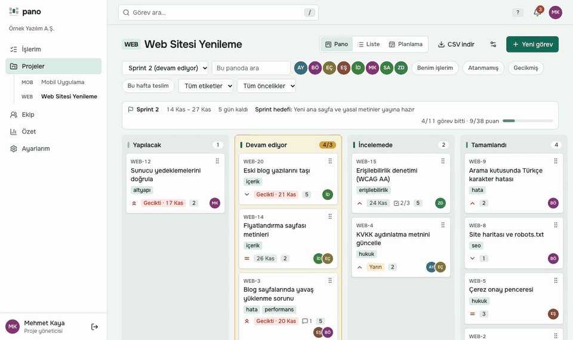
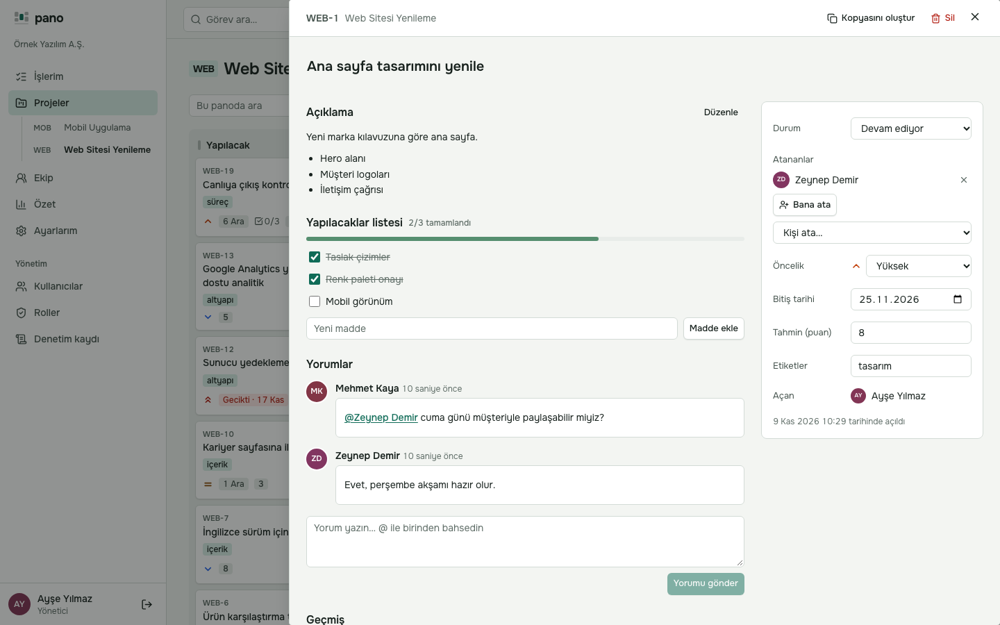
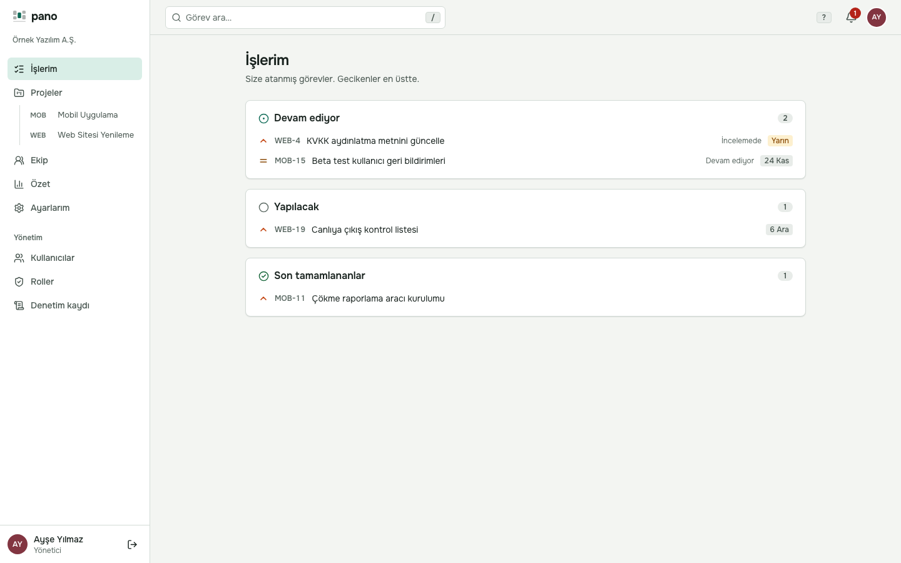
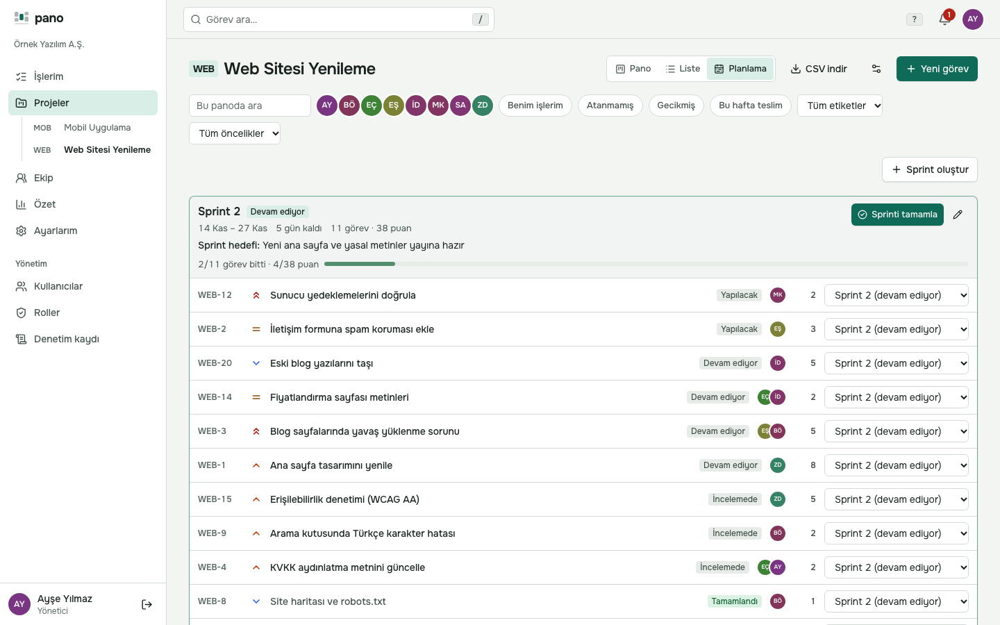
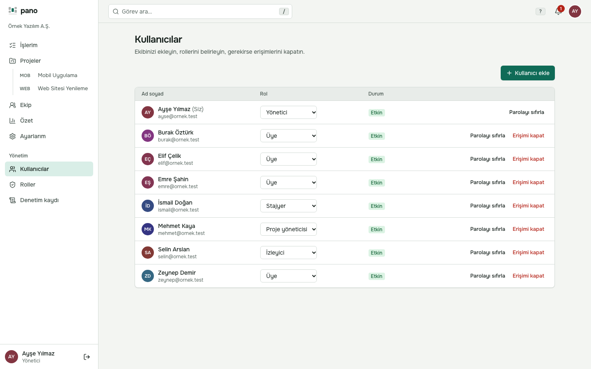
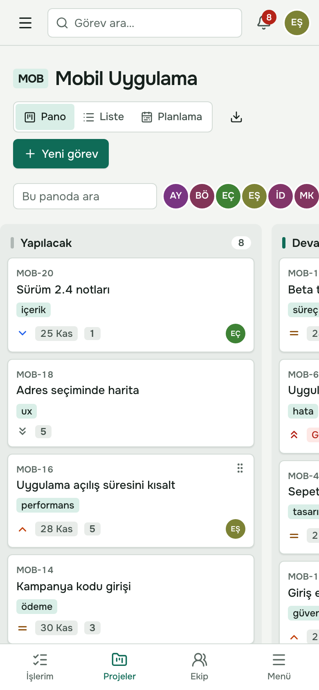
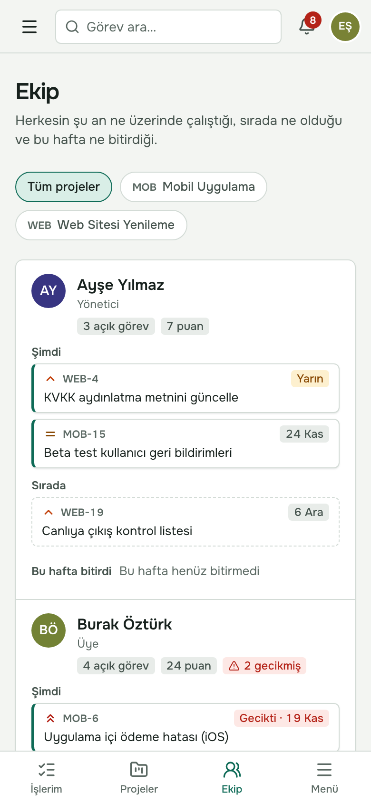
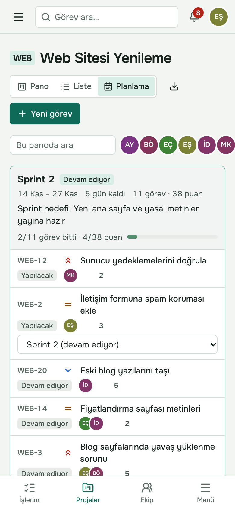

# pano

**pano** (Turkish for "board") is a web app a company uses to run its work on a board: a focused, friendly subset of Jira. Each company gets its own isolated workspace; the admin adds people, gives them roles and permissions, and everyone can see who is working on what, what is next and what got done. Turkish is the default language, English is complete.

**[Türkçe açıklama aşağıda ↓](#türkçe)**



| Board | Team: now / next / done this week |
| --- | --- |
|  |  |
| **Task detail** | **My work** |
|  |  |
| **Overview with sprint burndown** | **Sprint planning (Planlama)** |
|  |  |
| **English, dark mode (a read-only viewer)** | **Users and roles** |
|  |  |

<p>
  
  
  
  
</p>

All screenshots come from the running app with the demo data (`scripts/screenshots.ts`).

## Quickstart

Requirements: Node.js 22 and npm. No database server and no Docker needed.

```bash
npm install && npm run dev
```

Open <http://localhost:4500> and sign in with a demo login below. The first run creates the database ([PGlite](https://pglite.dev), Postgres compiled to WebAssembly, stored in `.data/pglite`) and seeds the demo company. Delete `.data/pglite` to start over.

Newer npm versions print that install scripts of `esbuild` and `fsevents` were blocked; nothing needs them, you can ignore it.

### Demo logins

All demo accounts are fictional and share the password **`PanoDemo2026`** (demo only).

| Email | Name | Role |
| --- | --- | --- |
| `ayse@ornek.test` | Ayşe Yılmaz | Admin (Yönetici) |
| `mehmet@ornek.test` | Mehmet Kaya | Manager (Proje yöneticisi) |
| `zeynep@ornek.test` | Zeynep Demir | Member (Üye) |
| `emre@ornek.test` | Emre Şahin | Member |
| `elif@ornek.test` | Elif Çelik | Member |
| `burak@ornek.test` | Burak Öztürk | Member |
| `ismail@ornek.test` | İsmail Doğan | Custom role "Stajyer" (intern) |
| `selin@ornek.test` | Selin Arslan | Viewer (İzleyici), interface in English |

The demo company "Örnek Yazılım A.Ş." has two projects (WEB, MOB), the built-in Genel İşler board (GEN) and 45 tasks in Turkish at various states. WEB works in sprints (one completed, one running, one planned); MOB is a plain kanban board. You can also create your own company at `/signup`.

### Trying it on your phone

`npm run dev` prints a "Network" address, but the dev server does not serve its scripts to other devices, and session cookies are `Secure` (sent only over HTTPS or to `localhost`), so signing in from a phone over plain HTTP cannot work (the sign-in page warns when it detects this). For a local try-out on the same Wi-Fi, run a production build without the `Secure` flag:

```bash
npm run build
COOKIE_SECURE=false npm start    # then open http://<your computer's IP>:4500 on the phone
```

## What it does

**Companies and people**
- Company sign-up creates an isolated workspace; the first user is its admin.
- Admins add users (name, email, role, language) and either get a one-time **invite link** (valid 7 days) or set a **temporary password** that must be changed at first sign-in. No email is sent in v0.1; the link is shown once to copy. `src/server/mail.ts` is the hook for SMTP.
- Built-in roles **Admin**, **Manager**, **Member**, **Viewer** (read-only), and **custom roles** made by ticking permissions (see the matrix below).
- Every new company starts with a **Genel İşler** board (GEN; "General" when the founder signs up in English) for work that belongs to no project: office, purchasing, HR. It is an ordinary project open to everyone, so it can be renamed or restricted like any other.
- Projects can be **restricted** to selected people.
- Deactivating a user ends their sessions immediately and keeps their history. Their open tasks become unassigned (each task's history says so), so the work shows up under the *Unassigned* filter; finished tasks keep their name. Admins can reset passwords (new link or temporary password). The **audit log** records user created, role changed, access turned off/on, password reset, role created/changed/deleted and task deleted.

**The board**
- One kanban board per project. Default columns: Yapılacak / To do, Devam ediyor / In progress, İncelemede / In review, Tamamlandı / Done. Managers rename, add, reorder and delete (empty) columns, set each column's type (to do / in progress / done) and an optional **WIP limit**: the column turns amber when exceeded.
- Tasks have a key (e.g. `WEB-42`), title, Markdown description (raw HTML is never rendered), one or more assignees, reporter, priority with icons, labels, due date, estimate (points), a checklist with progress, comments with **@mentions** (suggestions while typing) and a full history.
- **Drag and drop** between and within columns with the mouse, a long press on touch screens, or the keyboard (focus a card's handle, Space, arrow keys, Space). The task panel's Status field is another keyboard-friendly way to move a task.
- **Assign to me** on the card and in the task panel; assign others from the panel. Moves are optimistic and roll back with a message if the server refuses.
- **Concurrent edits never silently overwrite each other**: every task change carries the version the user saw; a stale change is rejected and the latest version is loaded. A refused description edit stays open in the editor, so nothing typed is lost.
- Quick filters: my tasks, unassigned, overdue, due this week, assignee avatars, label, priority and text. A **list view** shows the same filtered tasks as a table.

**Sprints (optional)**
- A project can work in **sprints**; a team that does not want them never sees them. People who manage projects create sprints with optional dates and a **sprint goal**.
- The **Planlama / Backlog** tab lists the running sprint (progress in tasks and points, days left), planned sprints and the **backlog**. Each task row has a sprint picker, so planning works by keyboard and on a phone.
- **Starting** a sprint (one at a time per project) makes the board show only that sprint's tasks, with a strip showing dates, days left, goal and progress. **Completing** it keeps its done tasks as its record and moves the unfinished ones to the backlog or a planned sprint. Completed sprints show what they delivered (velocity).
- **Burndown** on the Overview page for each running sprint: remaining work, scope, tasks done, ahead of / behind the ideal line, and a day-by-day chart (also as a table). It counts points, or tasks when nothing is estimated. Work added mid-sprint counts from the day it was added; a task that was finished and later reopened counts as done on the days it was done (both read from the task history); work taken out of the sprint is not counted.

**Seeing what everyone is doing**
- **My work (İşlerim)**: my tasks grouped in progress / to do / recently done, overdue first.
- **Team (Ekip)**: one row per person with what they are doing now, what is next and what they finished this week, with open-task and point counts and overdue warnings, filterable by project. Each person has a profile with the same view plus their recent activity.
- **Overview (Özet)** for people with "view reports": running sprints with their burndown, tasks by status, done per week (8 weeks), overdue list and workload per person.

**Extras**
- In-app **notifications** with an unread badge: assigned to you, mentioned, due tomorrow.
- **Keyboard shortcuts**: `c` new task, `/` search, `?` help, `Esc` closes dialogs.
- **Search** across all visible tasks, 50 per page, Turkish-aware: `istanbul` finds "İstanbul", `ılık` finds "ILIK", and Turkish letters are optional (`tasinmasi` finds "taşınması").
- **Copy task** (fields and checklist), **CSV export** per project (Excel-friendly, formula-safe, with a Sprint column).
- **Dark mode** (system, light or dark per user) and a **mobile layout** with a bottom tab bar.
- Each user picks a language; the sign-in page has a switch. Dates, numbers and plurals follow tr-TR / en-GB.

## Permissions

Every permission is checked on the server (`src/server/*`); the UI only hides what you cannot do.

| Permission | Admin | Manager | Member | Viewer | What it allows |
| --- | :-: | :-: | :-: | :-: | --- |
| Manage users | ✓ | | | | Add, deactivate, reactivate users, change their role, reset passwords, read the audit log |
| Manage roles | ✓ | | | | Create, change and delete custom roles |
| Manage projects | ✓ | ✓ | | | Create projects, restrict them, edit columns and WIP limits, run sprints |
| Create tasks | ✓ | ✓ | ✓ | | Create and copy tasks; edit tasks you reported or are assigned to |
| Edit any task | ✓ | ✓ | | | Edit and move every task |
| Delete tasks | ✓ | ✓ | | | Delete a task (recorded in the audit log) |
| Assign self | ✓ | ✓ | ✓ | | "Assign to me" |
| Assign others | ✓ | ✓ | ✓ | | Assign anyone who can see the project |
| Comment | ✓ | ✓ | ✓ | | Comment and @mention |
| View reports | ✓ | ✓ | | | Overview page (burndown, workload, overdue) |

- Everyone signed in can read the boards, tasks, My work and Team pages of the projects they can see.
- **Restricted projects** are visible to their selected people and to everyone with *Manage users* or *Manage projects*.
- Nobody can grant a permission they do not hold, or act on someone who holds more than they do. The company always keeps one active admin.
- The demo's custom role "Stajyer" has Create tasks, Assign self and Comment.

## Security

- **Tenant isolation**: every table row carries `workspace_id`; every service query filters by the caller's workspace and project visibility. Records from another company are answered with "not found", never "forbidden", so IDs leak nothing. `tests/tenant-isolation.test.ts` runs a company-B admin (who holds every permission) against company A's IDs for **every server action**, and a meta-test fails if an action is added without such a case.
- **Auth**: passwords hashed with scrypt (N=2^17, r=8, p=1, `node:crypto`). Sessions are random 256-bit tokens in an HttpOnly, Secure, SameSite=Lax cookie; only their SHA-256 is stored. Sessions end on sign-out, deactivation, role change, permission change of a custom role, password reset and password change. Invite and reset links work exactly once.
- **Abuse limits**: 5 wrong passwords lock an account for 15 minutes; per-IP limits on sign-in and company sign-up; 10 tries per 15 minutes to guess the current password when changing it. Password policy: at least 10 characters with letters and digits.
- **CSRF**: all mutations are Next.js Server Actions, which reject a foreign `Origin`; the only route handler is a read-only CSV download.
- **Input and output**: zod validation at every server boundary; Markdown without raw HTML and with unsafe URLs stripped; Content-Security-Policy, HSTS, Permissions-Policy, `X-Frame-Options: DENY`, `nosniff`.

How to report a vulnerability, and the known trade-offs: [SECURITY.md](SECURITY.md).

## Performance

Measured on a production build with the demo data plus 480 extra tasks in one project (a 500-task board), Chromium, Apple-silicon laptop:

| | Value |
| --- | --- |
| JavaScript on the sign-in page / My work | 154 / 157 KB gzip |
| JavaScript on a board | 194 KB gzip (238 KB before this round; Markdown now loads when a task opens) |
| 500-task board: server response | ~115 ms to first byte, 69 KB HTML over the wire |
| 500-task board: one keyboard drag step at 4× CPU slowdown | 0.4–0.6 s (1.0–1.2 s before this round; cards are memoized) |
| 500-task board: filter keystroke at 4× CPU slowdown | 65–120 ms |

The board renders every task of the project at once; it stays usable at 500 but is not built for many thousands (see Roadmap).

## Deploying

Production uses a real PostgreSQL via `DATABASE_URL`. Migrations run automatically when the app starts. The repository has a `Dockerfile` (Next.js standalone server, runs as a non-root user) and a `docker-compose.yml` with the app and Postgres 17.

```bash
export POSTGRES_PASSWORD='a-long-random-secret'
docker compose up -d --build        # app on http://localhost:4500, data in the pano-db volume
```

Open `/signup` to create your company (the demo seed is not run in Docker). To load the demo company into a Postgres anyway: `DATABASE_URL=postgres://… npm run seed`.

### Environment variables

| Variable | Default | Meaning |
| --- | --- | --- |
| `DATABASE_URL` | (unset: PGlite in `.data/pglite`) | Postgres connection string. Required in production. |
| `APP_TZ` | `Europe/Istanbul` | Time zone for due dates, "today", week boundaries and timestamps. One per installation. |
| `COOKIE_SECURE` | `true` | Session cookies are `Secure`. Keep `true` and serve over HTTPS; `false` only for plain-HTTP try-outs. |
| `PROXY_HOPS` | `1` | Number of reverse proxies in front of the app that append to `X-Forwarded-For`; the client IP for rate limits is read that many entries from the right. |
| `POSTGRES_PASSWORD` | `pano-local-only` | Used by `docker-compose.yml` for the database and the app's `DATABASE_URL`. Always set it. |
| `PANO_DB` | `.data/pglite` | PGlite directory for development (`memory://` for throwaway runs). Ignored when `DATABASE_URL` is set. |
| `SCRYPT_LOG_N` | `17` | Password-hash cost. Lowered only by the test suites for speed; never set it in production. |

### HTTPS and the reverse proxy

Put a reverse proxy with TLS in front of the app (Caddy, nginx, Traefik, a cloud load balancer) and forward to port 4500. The proxy must **append** the client address to `X-Forwarded-For` (all common proxies do), and `PROXY_HOPS` must equal the number of such proxies. Exposed without a proxy, a client can pick its own `X-Forwarded-For` and only the per-account lockout limits password guessing. A minimal Caddy setup:

```
pano.example.com {
    reverse_proxy localhost:4500
}
```

The per-IP limiters live in process memory, so run **one app instance** (or add a shared store first).

### Backups

All state is in Postgres (there are no uploaded files). With the compose setup:

```bash
# Back up (a compressed, consistent dump while the app keeps running)
docker compose exec -T db pg_dump -U pano -d pano -Fc > pano-$(date +%F).dump

# Restore into an empty database (stop the app first)
docker compose stop app
docker compose exec -T db pg_restore -U pano -d pano --clean --if-exists < pano-2026-11-22.dump
docker compose start app
```

Schedule the backup command (cron, a systemd timer) and keep copies off the machine. Test a restore now and then. Sessions are in the database too, so a restore signs people in or out as of the dump.

### Upgrading

Pull the new version and run `docker compose up -d --build`. The app applies new migrations from `drizzle/` at start-up; take a backup first.

## Development

```bash
npm run dev         # http://localhost:4500 (PGlite in .data/pglite, demo company seeded on first run)
npm test            # vitest: permissions, tenant isolation, sprints, business rules, reliability (in-memory PGlite)
npm run typecheck
npm run lint
npm run build && npm run e2e   # Playwright journeys against a production build on :4501
npx tsx scripts/screenshots.ts docs/screenshots   # with a seeded production build running on :4500
```

Stack: Next.js 16 (App Router, Server Actions) · React 19 · TypeScript · Drizzle ORM · PostgreSQL (PGlite locally) · Tailwind CSS 4 · dnd-kit · zod · vitest · Playwright.

```
src/db/             schema (Drizzle) and the connection (PGlite or Postgres)
src/server/         services: all business rules, permission checks and workspace scoping
src/app/actions.ts  thin Server Actions: session -> service
src/app/            pages (App Router)
src/components/     UI
src/lib/i18n/       tr.ts (source) and en.ts (type-checked to have the same keys)
drizzle/            SQL migrations (applied automatically at startup)
tests/ e2e/         vitest and Playwright
```

See [CONTRIBUTING.md](CONTRIBUTING.md) for the rules every change follows, and [CHANGELOG.md](CHANGELOG.md) for what changed and the notes for the next maintainer.

## Limits in v0.1

- The per-IP limiters (sign-in: 30 attempts, sign-up: 10 companies per 15 minutes) live in process memory: fine for one app instance.
- Account lockout can be triggered by anyone who knows an email address (5 wrong passwords block that account for 15 minutes); this trades availability for brute-force protection.
- One time zone per installation (`APP_TZ`).
- No email delivery yet (links are copied by the admin).
- The board loads all tasks of a project at once (measured fine at 500).
- Touch drag (long press) is tested in Chromium's phone emulation, not yet on a real phone.

## Roadmap

Not built yet, in rough priority order:
- Email delivery for invites, resets and notifications (SMTP behind `src/server/mail.ts`).
- Burndown for completed sprints (completing a sprint does not yet record per task that unfinished work moved out), and a scope-change line on the burndown.
- Task templates (copying a task covers the simplest case today).
- Editing and deleting comments; attachments.
- Realtime board updates (today the board refreshes after your own actions and on navigation; stale edits are caught by versioning).
- Board paging or virtualization for projects with thousands of open tasks.
- Content-Security-Policy with nonces.
- Per-company time zone, SSO, API tokens and webhooks.

---

## Türkçe

**pano**, şirketlerin işlerini tek panoda yürütmesi için yapılmış bir web uygulamasıdır; Jira'nın sade ve kullanımı kolay bir alt kümesi. Her şirketin kendi ayrı çalışma alanı vardır. Şirket hesabını açan kişi yönetici olur, ekibi ekler, rolleri ve yetkileri belirler. Herkes kimin neyle uğraştığını, sırada ne olduğunu ve bu hafta neyin bittiğini görür. Arayüz varsayılan olarak Türkçedir; İngilizce de tam olarak desteklenir.

### Hızlı başlangıç

Gerekenler: Node.js 22 ve npm. Veritabanı sunucusu ya da Docker gerekmez.

```bash
npm install && npm run dev
```

<http://localhost:4500> adresini açın ve aşağıdaki demo hesaplarından biriyle giriş yapın. İlk çalıştırmada veritabanı (`.data/pglite` klasöründe, WebAssembly ile çalışan Postgres) oluşturulur ve demo şirketi yüklenir. Baştan başlamak için `.data/pglite` klasörünü silin.

### Demo hesapları

Hepsi kurgusaldır ve aynı parolayı kullanır: **`PanoDemo2026`** (yalnızca demo için).

| E-posta | Ad | Rol |
| --- | --- | --- |
| `ayse@ornek.test` | Ayşe Yılmaz | Yönetici |
| `mehmet@ornek.test` | Mehmet Kaya | Proje yöneticisi |
| `zeynep@ornek.test`, `emre@…`, `elif@…`, `burak@…` | Zeynep Demir, Emre Şahin, Elif Çelik, Burak Öztürk | Üye |
| `ismail@ornek.test` | İsmail Doğan | Özel rol "Stajyer" |
| `selin@ornek.test` | Selin Arslan | İzleyici (salt okunur), arayüzü İngilizce |

Demo şirketi "Örnek Yazılım A.Ş." iki proje (WEB, MOB), her şirkette hazır gelen Genel İşler panosu (GEN) ve farklı durumlarda 45 görev içerir. WEB sprintlerle çalışır, MOB sade bir kanban panosudur. `/signup` adresinden kendi şirketinizi de açabilirsiniz.

### Neler var

- **Pano**: Yapılacak, Devam ediyor, İncelemede, Tamamlandı sütunları; sürükle-bırak (fare, telefonda uzun basma ya da klavye), sütun başına iş sınırı (aşılınca sütun sarıya döner), "Bana ata", hızlı filtreler (görevlerim, atanmamış, gecikmiş, bu hafta teslim, kişi, etiket, öncelik) ve liste görünümü.
- **Görevler**: `WEB-42` gibi anahtar, Markdown açıklama, birden çok kişiye atama, öncelik, etiket, bitiş tarihi, puan tahmini, yapılacaklar listesi, @bahsetmeli yorumlar ve tam geçmiş. Aynı görevi aynı anda düzenleyen iki kişiden biri diğerinin değişikliğini fark etmeden silemez.
- **Sprintler** (isteğe bağlı): planlama sekmesi, sprint hedefi, sprinti başlatma ve bitirme, Özet sayfasında günlük kalan iş grafiği (burndown).
- **Kim ne yapıyor**: *İşlerim* (benim görevlerim, gecikenler önce), *Ekip* (her kişi için şimdi, sırada ve bu hafta bitirdikleri), kişi profili ve yöneticiler için *Özet* panosu (duruma göre görevler, haftalık bitenler, gecikenler, kişi başı iş yükü).
- **Diğer**: uygulama içi bildirimler, klavye kısayolları (`c` yeni görev, `/` arama, `?` yardım), Türkçe karakter duyarlı arama (`istanbul` yazınca "İstanbul" bulunur), görev kopyalama, CSV dışa aktarma, koyu tema ve telefona uygun arayüz.
- **Yetkiler**: Yönetici, Proje yöneticisi, Üye, İzleyici rolleri ve işaretlenen yetkilerden oluşan özel roller (yukarıdaki [yetki tablosu](#permissions)). Tüm yetkiler sunucuda denetlenir. Bir şirket başka bir şirketin verisini hiçbir yoldan göremez; bu, her sunucu işlemi için testle doğrulanır.

### Sunucuya kurulum

Docker Compose ile uygulama ve PostgreSQL birlikte çalışır:

```bash
export POSTGRES_PASSWORD='uzun-ve-rastgele-bir-parola'
docker compose up -d --build
```

Önüne HTTPS sağlayan bir ters vekil sunucu (ör. Caddy, nginx) koyun. Yedek almak için:

```bash
docker compose exec -T db pg_dump -U pano -d pano -Fc > pano-$(date +%F).dump
```

Ortam değişkenleri, geri yükleme ve güncelleme adımları için İngilizce [Deploying](#deploying) bölümüne bakın. Güvenlik açığı bildirmek için: [SECURITY.md](SECURITY.md).

## License

[MIT](LICENSE) © Habibeyilmazz
